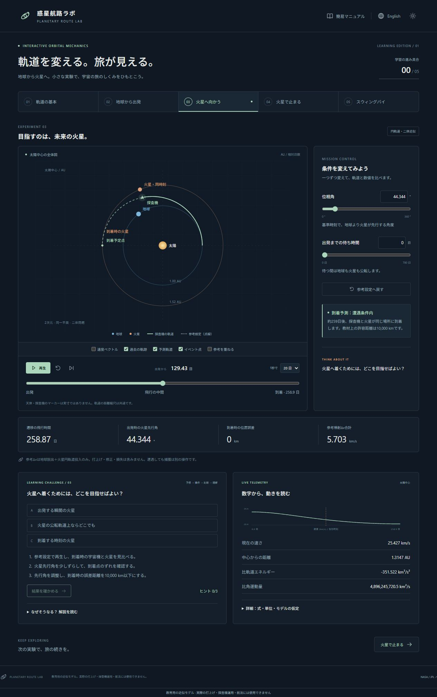
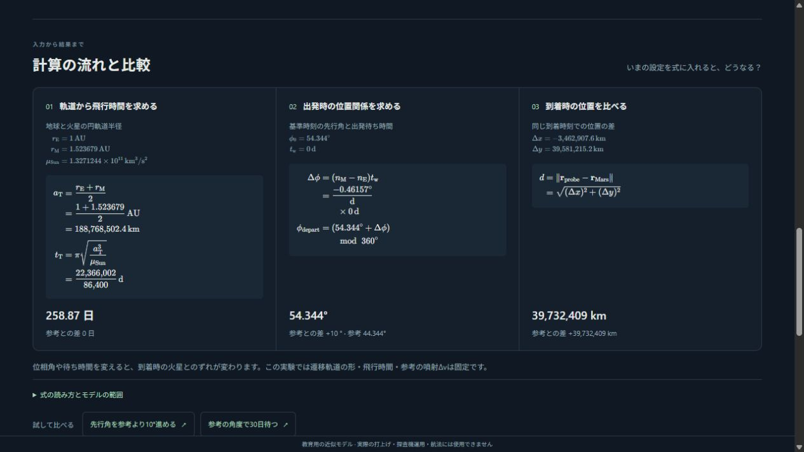

# 惑星航路ラボ / Planetary Route Lab

**[ブラウザーで体験する / Open the app](https://takayuki-minagawa.github.io/space-probe/)**

地球から火星へ向かう探査機を題材に、出発時期や噴射量が軌道に与える影響を学ぶWeb教材です。「予想する → 条件を変える → 軌道と数値を比べる → 理由を読む」という流れで、宇宙の旅のしくみを確かめられます。

Explore how departure timing and burns affect a spacecraft’s journey from Earth to Mars. Predict an outcome, change a setting, compare the trajectory and values, then read the explanation.

日本語／英語、ライト／ダーク表示に対応し、簡易マニュアルも両言語で利用できます。初期言語は日本語です。アカウント登録やインストールは必要ありません。

Japanese and English, light and dark themes, and a bilingual quick guide are available. Japanese is the default. No account or installation is required.



## はじめての実験 / First experiment

1. 「火星へ向かう」の参考設定で「到着」へ移動し、探査機と火星の位置を見比べます。
2. 位相角を少し変え、再び「到着」へ移動して、ずれがどう変わるか確かめます。
3. 「参考設定へ戻す」で比較の基準に戻り、予想・ヒント・解説を読みます。

**English**

1. Open **Journey to Mars** and jump to **Arrival** with the reference settings.
2. Change the phase angle, jump to **Arrival** again, and compare the spacecraft’s position with Mars.
3. Use **Restore reference**, then explore the prediction, hints, and explanation.

## 学べること / What you can explore

| 実験 / Lab                      | 操作と発見 / Change and observe                                                                                                      |
| ------------------------------- | ------------------------------------------------------------------------------------------------------------------------------------ |
| 軌道の基本 / Orbit basics       | 加速・減速すると、円軌道がどのように変わるか。 / How a burn changes a circular orbit.                                                |
| 地球から出発 / Leave Earth      | 同じ脱出目標でも、待機高度によって必要なΔvがどう変わるか。 / How parking altitude affects the burn needed for a fixed escape target. |
| 火星へ向かう / Journey to Mars  | なぜ現在の火星ではなく、到着時の火星を目指すのか。 / Why a spacecraft must meet Mars where it will be at arrival.                    |
| 火星で止まる / Capture at Mars  | なぜ接近するだけでは周回できず、減速が必要なのか。 / Why arrival alone does not put a spacecraft into orbit.                         |
| スウィングバイ / Gravity assist | 惑星との遭遇で、太陽から見た速さが増減するのはなぜか。 / How a planetary encounter changes Sun-relative speed.                       |

各実験では、数値入力とスライダー、再生・停止・ステップ・時間移動、参考軌道の重ね合わせを使えます。「計算の流れと比較」では入力値から結果までをたどり、試す例と参考設定との差を確認できます。

Each lab provides numeric inputs, sliders, playback, stepping, timeline navigation, and a reference overlay. **Follow the calculation** connects inputs to results, with example settings and comparisons to the reference.

数式はTeXで組版し、分数・平方根・添字・ベクトルを表示します。数式用フォントもサイトに同梱しています。

Equations are typeset from TeX, with fractions, roots, subscripts, and vectors. Math fonts are bundled with the site.



Tabで操作項目を移動し、ボタンはEnter／Space、スライダーは矢印キーで操作できます。自動再生はありません。言語と配色は同じブラウザーに保存されます。実験条件と課題の進捗は再読み込みでリセットされます。

Navigate with Tab, use Enter/Space for buttons, and arrow keys for sliders. Nothing autoplays. Language and theme are saved in your browser; experiment settings and challenge progress reset on reload.

## 計算モデル / Model

**教育用の近似モデルです。実際の打上げ・探査機運用・航法には使用できません。**

**An educational approximation, not for actual launch, spacecraft operations, or navigation.**

- 2次元・同一平面・惑星の円軌道・二体重力・瞬時噴射を仮定します。 / Two dimensions, one plane, circular planetary orbits, two-body gravity, and instantaneous burns.
- 火星遷移と各局所実験は、それぞれ独立した座標系・時刻で計算します。有限の作用圏で接続した一本の航路ではありません。 / The transfer and local labs use separate frames and clocks; they are not a trajectory joined at finite spheres of influence.
- 遭遇課題は、指定到着時刻での距離が10,000 km以下なら達成です。捕獲・目標円軌道の達成は別に判定します。 / The encounter challenge uses a 10,000 km arrival tolerance; capture and target-orbit attainment are evaluated separately.
- 火星への参考飛行時間は約259日です。位相角や出発待ち時間を変えると遭遇位置が変わりますが、この固定ホーマン遷移の飛行時間は変わりません。 / The reference flight takes about 259 days. Phase and departure wait change the encounter geometry, not the fixed Hohmann flight duration.
- 月への飛行、地表打上げ、大気、有限燃焼、3D、多天体摂動、実暦による打上げ窓は扱いません。 / Lunar flights, surface launch, atmospheres, finite burns, 3D, perturbations, and calendar launch windows are outside the model.

数式・定数・判定条件・参考値は [モデル仕様 / Model specification](docs/MODEL_SPEC.md)、参考資料と依存ライブラリは [出典 / Sources](docs/SOURCES.md) にまとめています。

## 関連する学習アプリ / Related learning apps

同じ作者の教材を、学びたい内容に応じて選べます。惑星航路ラボでは、探査機の出発・飛行・減速を操作して学びます。

Explore these related apps by the same author. Planetary Route Lab focuses on changing a spacecraft’s departure, flight geometry, and braking.

| アプリ / App                                                                                                      | 主なテーマ / Focus                                                                                  |
| ----------------------------------------------------------------------------------------------------------------- | --------------------------------------------------------------------------------------------------- |
| [GEO LEARNER](https://takayuki-minagawa.github.io/GEO-LEARNER/)                                                   | 他の天体から地球がどう見えるか。 / How Earth looks from other bodies.                               |
| [Web Planetarium](https://takayuki-minagawa.github.io/web-planetarium/)                                           | 日時と場所に応じた星空観察。 / The sky at a chosen date and location.                               |
| [月の満ち欠け・日食月食 / Moon phases and eclipses](https://takayuki-minagawa.github.io/moon-phases-eclipse-sim/) | 太陽・地球・月の配置と光・影。 / Sun–Earth–Moon geometry, light, and shadow.                        |
| [年周視差 / Stellar parallax](https://takayuki-minagawa.github.io/stellar-parallax-sim/)                          | 見かけの位置変化から恒星の距離を測る。 / Measuring stellar distance from apparent position changes. |
| [季節と太陽高度 / Seasons and solar altitude](https://takayuki-minagawa.github.io/solar-altitude-sim/)            | 緯度・季節・時刻と太陽の見え方。 / Latitude, seasons, time, and the Sun’s position.                 |

## ローカルで動かす / Run locally

[.nvmrc](.nvmrc) のNode.jsとnpmを使用します。依存バージョンは [package.json](package.json) と [package-lock.json](package-lock.json) で管理しています。

Use the Node.js version in [.nvmrc](.nvmrc) and npm. Dependency versions are recorded in [package.json](package.json) and [package-lock.json](package-lock.json).

```sh
npm ci
npm run dev
```

ターミナルに表示されるURLを開いてください。計算はブラウザー内で行い、外部APIやCDN、外部フォントは使用しません。初回の依存インストールにはネットワーク接続が必要です。

Open the URL printed in the terminal. Calculations run in the browser without external APIs, CDNs, or fonts. Installing dependencies requires network access.

```sh
npm run typecheck
npm run lint
npm test
npm run build
npx playwright install chromium
npm run test:e2e
npm run preview
```

ビルド成果物は `dist/` です。ローカルでもHTTPサーバー経由で開きます。環境ごとの実行手順は [開発ガイド / Development guide](docs/DEVELOPMENT_PLAN.md) を参照してください。

Build output is in `dist/` and should be served over HTTP. See the [development guide](docs/DEVELOPMENT_PLAN.md) for environment-specific setup.

## 公開と品質確認 / Deployment and checks

`main` へのpushで、型検査・lint・単体／UIテスト・ビルド・ブラウザーテストを実行し、成功した成果物をGitHub Pagesへ公開します。手動実行は **Actions → Deploy GitHub Pages → Run workflow → main** から行えます。別のリポジトリで使う場合は、**Settings → Pages → Source → GitHub Actions** を設定してください。

Pushes to `main` run type checks, lint, unit/UI tests, build, and browser tests before publishing to GitHub Pages. To deploy manually, use **Actions → Deploy GitHub Pages → Run workflow → main**. For another repository, set **Settings → Pages → Source → GitHub Actions**.

- [CIの実行結果 / CI runs](https://github.com/Takayuki-Minagawa/space-probe/actions/workflows/ci.yml)
- [公開ワークフロー / Deployment runs](https://github.com/Takayuki-Minagawa/space-probe/actions/workflows/pages.yml)

CIではChromiumのデスクトップ表示とモバイル表示のエミュレーションを検査します。実機の全ブラウザーでの動作を保証するものではありません。

CI tests desktop and emulated mobile layouts in Chromium. This does not establish compatibility with every physical device or browser.
